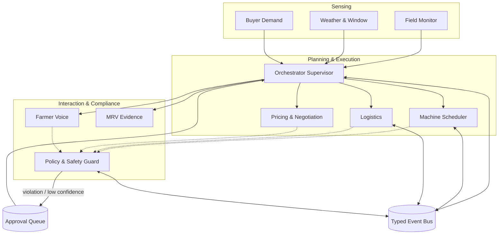

# StubbleOS Multi-Agent System Specification

This document details the multi-agent system architecture for StubbleOS Phase 4, including typed inputs, outputs, tools, failure modes, and human-in-the-loop triggers for all 10 agents.

---

## 1. Orchestrator (Supervisor)

- **Package**: `stubbleos.agents.orchestrator`
- **Role**: Central supervisor owning the per-district per-day plan, work routing, conflict resolution, plan versioning, and human-in-the-loop escalations.
- **Inputs**:
  - `OrchestratorInput`: district, plan_date, strategy (`centralized` or `decentralized`), list of `JobRequest`s, `MachineResource`s, `FieldPickup`s, `BuyerDropoff`s, `TruckSpec`s, `BuyerOrderModel`s, optional `replan_trigger`, optional `previous_plan`.
- **Outputs**:
  - `DistrictPlan`: Unique `plan_id`, district, date, version number, parent plan ID (if superseding), assignments, routes, objective score, solver status, calibrated confidence.
- **Tools**:
  - `persist_plan`: Writes plan to `core.plans` and marks superseded versions.
  - `record_approval_request`: Inserts pending human approval into `core.approvals`.
  - `publish_plan_created_event`: Emits typed `PlanCreated` event.
- **Failure Modes & HITL**:
  - Low confidence (< 0.70) or Policy Guard block triggers LangGraph `interrupt(...)`. Resumes on `ApprovalResolved`.
  - Environmental / mechanical shocks (`rain_forecast_change`, `machine_breakdown`, `burn_detected`) trigger dynamic replanning and plan version increment.

---

## 2. Machine Scheduler Agent

- **Package**: `stubbleos.agents.machine_scheduler`
- **Role**: Wraps global CP-SAT optimization and decentralized Contract-Net auctions.
- **CRITICAL INVARIANT**: **The LLM only explains and negotiates around the optimizer output, and NEVER changes assignments.**
- **Inputs**:
  - `MachineSchedulerInput`: jobs, machines, mode (`cpsat` or `auction`), solver config, current simulation hour, request_explanation flag.
- **Outputs**:
  - `MachineSchedulerOutput`: exact `ScheduleAssignment`s, unassigned job IDs, objective value, solver status, auditable explanation, conflict tie-break logs.
- **Tools**:
  - `schedule_machinery`: Runs CP-SAT solver or Contract-Net coordinator.
- **Failure Modes**:
  - Solver timeout: Defaults to best feasible solution found within deadline.
  - Infeasibility: Escalated to Orchestrator for conflict mediation and smallholder protection.

---

## 3. Logistics Agent

- **Package**: `stubbleos.agents.logistics`
- **Role**: Coordinates biomass baling transport from field pickup nodes to industrial buyer dropoffs via VRPTW.
- **Inputs**:
  - `LogisticsInput`: pickups, dropoffs, commercial trucks, routing config (CO2 weight, speed), request_explanation flag.
- **Outputs**:
  - `LogisticsOutput`: `TruckRoute`s with stop-level timestamps and loads, total distance (km), total cost (INR), total CO2 (kg), delivered tonnage, unserved field IDs, solver status.
- **Tools**:
  - `compute_straw_routes`: Multi-depot VRP delivery routing.
- **Failure Modes**:
  - OSRM service failure: Automatically falls back to Haversine distance matrix with 1.3x road winding factor.
  - Fleet capacity exhaustion: Explicitly identifies unserved fields for staging.

---

## 4. Buyer Demand Agent

- **Package**: `stubbleos.agents.buyer_demand`
- **Role**: Models and aggregates commercial purchase orders, publishing the district Order Book.
- **Inputs**:
  - `BuyerDemandInput`: district, target date, order list, moisture filter, request_explanation flag.
- **Outputs**:
  - `OrderBook`: total tonnage demanded, filled tonnage, open tonnage, price range, volume-weighted average price, active order list, demand commentary.
- **Tools**:
  - `query_order_book`: Retrieves active buyer contracts and moisture specifications.
- **Failure Modes**:
  - No active orders: Returns zero demand metrics and alerts Orchestrator of market gap.

---

## 5. Policy & Safety Guard

- **Package**: `stubbleos.agents.policy_guard`
- **Role**: Cross-cutting compliance firewall run on every outbound action.
- **Inputs**:
  - `PolicyCheckRequest`: action reference, optional farmer ID, consent purpose, communication channel, timestamp, proposed price, price bounds, message text, metadata payload.
- **Outputs**:
  - `PolicyCheckResult`: `is_allowed` flag, list of `PolicyViolation` records (`CONSENT_REQUIRED`, `PRICE_OUT_OF_BOUNDS`, `PII_LEAK_DETECTED`, `OUTSIDE_ALLOWED_HOURS`).
- **Tools**:
  - `validate_action`, `scan_for_pii`, `check_farmer_consent`, `check_allowed_contact_hours`.
- **Failure Modes**:
  - Revoked consent, PII in message, out-of-bounds price, or contact outside 08:00–19:00 IST blocks action (`is_allowed = False`) and emits `PolicyViolationDetected`.

---

## 6. Field Monitor Agent (Phase 4 Skeleton)

- **Package**: `stubbleos.agents.field_monitor`
- **Role**: Satellite sensing (Sentinel-2 NDVI, FIRMS thermal hotspots) for harvest readiness and fire detection.
- **Inputs**: `FieldMonitorInput` (district, field IDs, window hours).
- **Outputs**: `FieldMonitorOutput` (`FieldObservation`s, newly harvested counts, burn counts).
- **Tools**: `sentinel2_harvest_detector_mock`, `firms_thermal_anomaly_detector_mock`.

---

## 7. Weather & Window Agent (Phase 4 Skeleton)

- **Package**: `stubbleos.agents.weather_window`
- **Role**: Forecasts meteorological operational windows and field workability.
- **Inputs**: `WeatherWindowInput` (district, start date, end date).
- **Outputs**: `WeatherWindowOutput` (daily forecasts, rain probability, workable days count, agronomic advisory).
- **Tools**: `fetch_weather_forecast_mock`, `check_drying_conditions_mock`.

---

## 8. Farmer Voice Agent (Phase 4 Skeleton)

- **Package**: `stubbleos.agents.farmer_voice`
- **Role**: Automated vernacular conversational dialogue (Punjabi, Hindi, English) for machine booking.
- **Inputs**: `FarmerVoiceInput` (farmer ID, conversation ID, language, message text/audio).
- **Outputs**: `FarmerVoiceOutput` (vernacular reply, detected intent, escalation flag).
- **Tools**: `transcribe_audio_mock`, `synthesize_speech_mock`.

---

## 9. Pricing & Negotiation Agent (Phase 4 Skeleton)

- **Package**: `stubbleos.agents.pricing_negotiation`
- **Role**: Dynamic tariff quotes with smallholder concessions.
- **Inputs**: `PricingInput` (farmer ID, field ID, landholding class, service type, area).
- **Outputs**: `PricingOutput` (`TariffQuote` with base tariff, discount, and net cost).
- **Tools**: `compute_dynamic_tariff_mock`.

---

## 10. MRV Agent (Phase 4 Skeleton)

- **Package**: `stubbleos.agents.mrv`
- **Role**: Measures avoided burning, calculates CO2e savings, and generates cryptographically signed impact proofs (`indicative impact record (not registry-verified)`).
- **Inputs**: `MrvInput` (field ID, area acres, season, burn avoided boolean).
- **Outputs**: `MrvOutput` (`ImpactEstimate` with CO2e avoided and SHA256 checksum).
- **Tools**: `generate_mrv_evidence_mock`.
