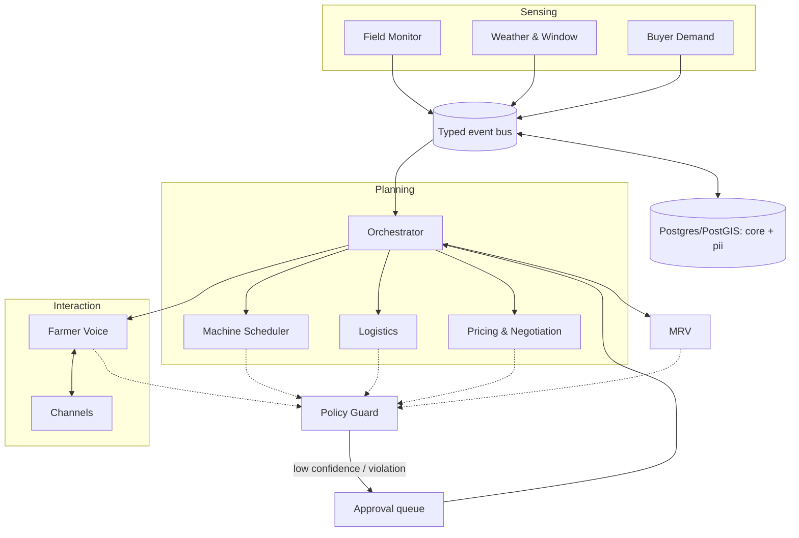

# Architecture

StubbleOS is a supervisor + specialist multi-agent system. Optimizers (OR-Tools) make allocation and routing decisions; LLMs converse, explain and negotiate around those decisions. Agents exchange typed events, not free text.

## What exists in Phase 1

| Module | Responsibility |
|---|---|
| `core.types` | Shared enums and strict Pydantic base models |
| `core.events` | `EventPayload` registry, `Event` envelope, in-memory and Redis buses |
| `core.clock`, `core.ids` | Injectable time and seeded IDs, for deterministic simulation |
| `core.privacy`, `core.logging` | Redaction, HMAC pseudonyms, structlog with redaction always on |
| `core.retry`, `core.telemetry`, `core.metrics` | Backoff and timeouts, optional OTel spans, Prometheus counters |
| `llm.*` | `LLMClient` protocol, `FakeLLM`, Anthropic adapter, versioned prompt registry |
| `data.*` | ORM models (`core` and `pii` schemas), migrations, consent and audit repositories, event sink |
| `api.app` | `/healthz`, `/readyz`, `/metrics` |

## Event contract

* Every message is an `EventPayload` subclass registered with `@register_event("domain.name")`.
* `Event` is the envelope: `event_id`, `event_type`, `source`, `ts` (timezone-aware, from the injected clock), `correlation_id`, `district`, `payload` (JSON).
* `bus.emit(payload, source=...)` stamps time and id from the bus's clock and id factory. Publishing an unregistered type raises `UnknownEventType`.
* Subscribers match with fnmatch globs (`field.*`, `*`) and call `event.typed_payload()` to get the validated model back.
* Handler exceptions are isolated into `bus.dead_letters`; a dispatch-depth guard stops runaway event loops.

## PII boundary

Schema `core` holds only pseudonymous, analytics-safe rows. Schema `pii` holds names, phones, buyer contacts and raw message text, joined by id. Erasure nulls the `pii` columns and leaves `core` intact. Logs pass through a redaction processor. See ADR-0003.

## Audit and consent

* `core.consents` is an append-only ledger; the latest entry decides, and a same-instant revocation wins. The Policy Guard (Phase 4) will call `ConsentRepository.has_valid_consent` before any outreach.
* `core.audit_log` is hash-chained and protected by a Postgres trigger against UPDATE, DELETE and TRUNCATE. `AuditLogRepository.verify_chain` detects tampering. See ADR-0004.
